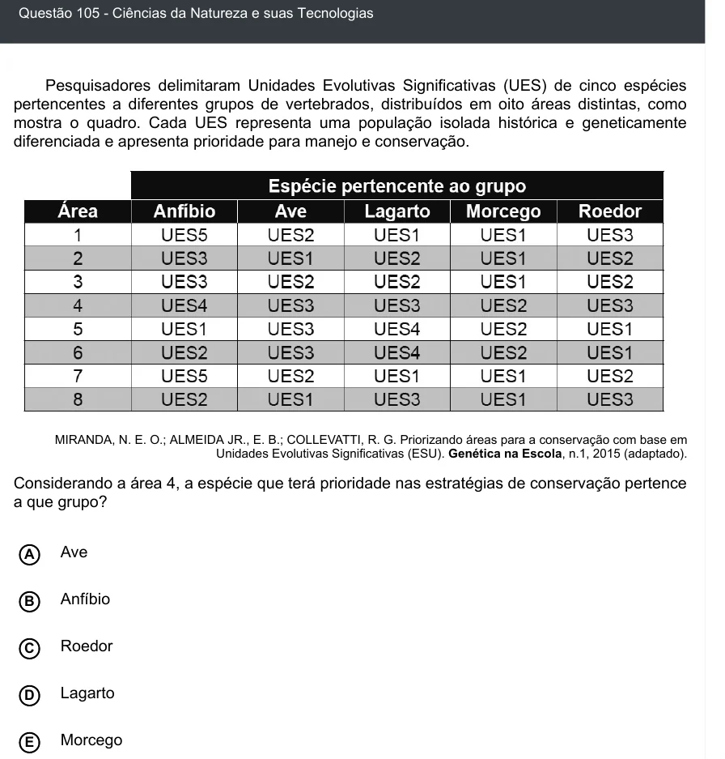

Texto extraído (pode conter ruído)

Questão 105 - Ciências da Natureza e suas Tecnologias  
Pesquisadores delimitaram Unidades Evolutivas Significativas (UES) de cinco espécies  
pertencentes a diferentes grupos de vertebrados, distribuídos em oito áreas distintas, como  
mostra o quadro. Cada UES representa uma população isolada histórica e geneticamente  
diferenciada e apresenta prioridade para manejo e conservação.  
MIRANDA, N. E. O.; ALMEIDA JR., E. B.; COLLEVATTI, R. G. Priorizando áreas para a conservação com base em  
Unidades Evolutivas Significativas (ESU). Genética na Escola, n.1, 2015 (adaptado).  
Considerando a área 4, a espécie que terá prioridade nas estratégias de conservação pertence  
a que grupo?  
Ave  
A  
Anfíbio  
B  
Roedor  
C  
D  
Lagarto  
Morcego  
E

