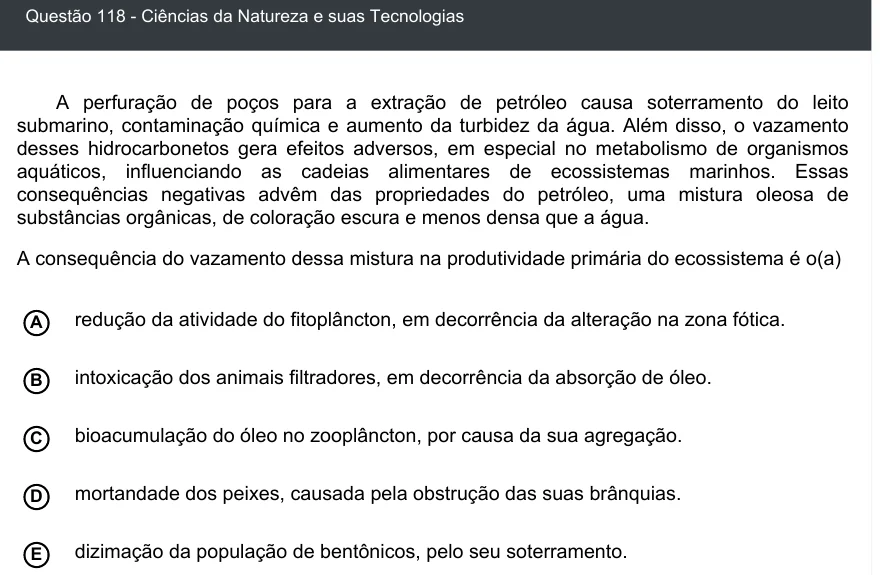

Texto extraído (pode conter ruído)

Questão 118 - Ciências da Natureza e suas Tecnologias  
A perfuração de poços para a extração de petróleo causa soterramento do leito  
submarino, contaminação química e aumento da turbidez da água. Além disso, o vazamento  
desses hidrocarbonetos gera efeitos adversos, em especial no metabolismo de organismos  
aquáticos, influenciando as cadeias alimentares de ecossistemas marinhos. Essas  
consequências negativas advêm das propriedades do petróleo, uma mistura oleosa de  
substâncias orgânicas, de coloração escura e menos densa que a água.  
A consequência do vazamento dessa mistura na produtividade primária do ecossistema é o(a)  
redução da atividade do fitoplâncton, em decorrência da alteração na zona fótica.  
A  
B  
intoxicação dos animais filtradores, em decorrência da absorção de óleo.  
bioacumulação do óleo no zooplâncton, por causa da sua agregação.  
C  
mortandade dos peixes, causada pela obstrução das suas brânquias.  
D  
E  
dizimação da população de bentônicos, pelo seu soterramento.

