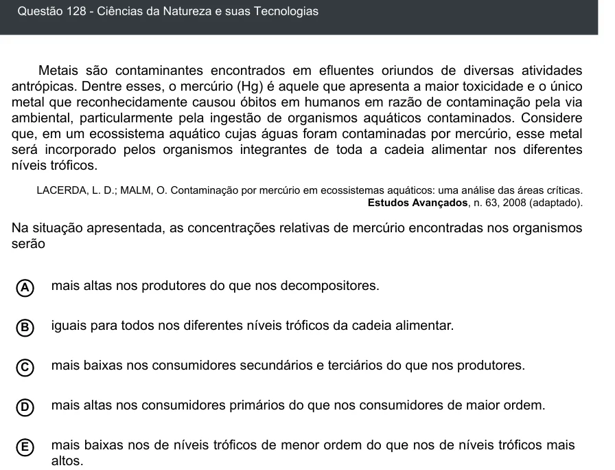

Texto extraído (pode conter ruído)

Questão 128 - Ciências da Natureza e suas Tecnologias  
Metais são contaminantes encontrados em efluentes oriundos de diversas atividades  
antrópicas. Dentre esses, o mercúrio (Hg) é aquele que apresenta a maior toxicidade e o único  
metal que reconhecidamente causou óbitos em humanos em razão de contaminação pela via  
ambiental, particularmente pela ingestão de organismos aquáticos contaminados. Considere  
que, em um ecossistema aquático cujas águas foram contaminadas por mercúrio, esse metal  
será incorporado pelos organismos integrantes de toda a cadeia alimentar nos diferentes  
níveis tróficos.  
LACERDA, L. D.; MALM, O. Contaminação por mercúrio em ecossistemas aquáticos: uma análise das áreas críticas.  
Estudos Avançados, n. 63, 2008 (adaptado).  
Na situação apresentada, as concentrações relativas de mercúrio encontradas nos organismos  
serão  
mais altas nos produtores do que nos decompositores.  
A  
iguais para todos nos diferentes níveis tróficos da cadeia alimentar.  
B  
mais baixas nos consumidores secundários e terciários do que nos produtores.  
C  
D  
mais altas nos consumidores primários do que nos consumidores de maior ordem.  
mais baixas nos de níveis tróficos de menor ordem do que nos de níveis tróficos mais  
E  
altos.

