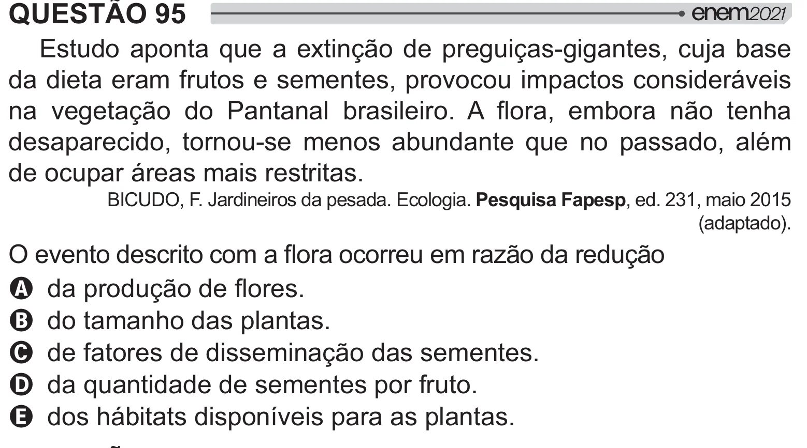

Texto extraído (pode conter ruído)

QUESTÃO 95  
Estudo aponta que a extinção de preguiças-gigantes, cuja base  
da dieta eram frutos e sementes, provocou impactos consideráveis  
 "  =[    y  !  } y [ $  
desaparecido, tornou-se menos abundante que no passado, além  
de ocupar áreas mais restritas.  
BICUDO, F. Jardineiros da pesada. Ecologia. Pesquisa Fapesp, ed. 231, maio 2015  
(adaptado).  
 "    }  [  =[  
A # =[ } !  
B do tamanho das plantas.  
C de fatores de disseminação das sementes.  
D da quantidade de sementes por fruto.  
E dos hábitats disponíveis para as plantas.

