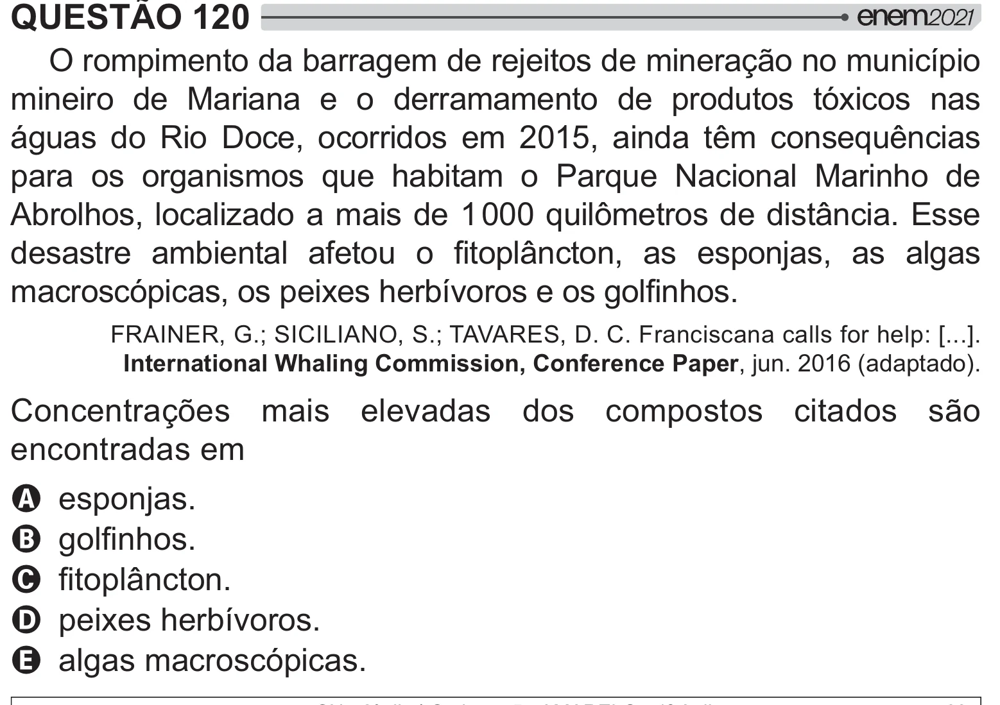

Texto extraído (pode conter ruído)

QUESTÃO 120  
O rompimento da barragem de rejeitos de mineração no município  
mineiro de Mariana e o derramamento de produtos tóxicos nas  
águas do Rio Doce, ocorridos em 2015, ainda têm consequências  
para os organismos que habitam o Parque Nacional Marinho de  
y$   `___ 2    ­!  
  
    y   >     #­    #‡       
 ƒ#  # * $ y{"   $ !  
FRAINER, G.; SICILIANO, S.; TAVARES, D. C. Franciscana calls for help: [...].  
International Whaling Commission, Conference Paper, jun. 2016 (adaptado).  
Concentrações mais elevadas dos compostos citados são  
encontradas em  
A esponjas.  
B $ !  
C  #­ !  
D peixes herbívoros.  
E algas macroscópicas.

