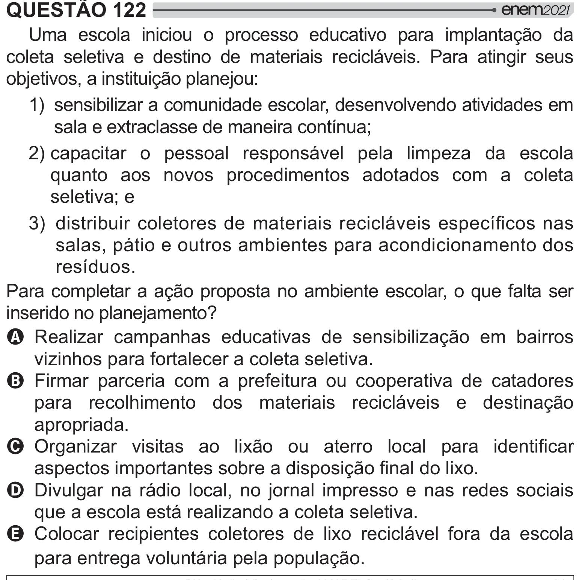

Texto extraído (pode conter ruído)

QUESTÃO 122  
Uma escola iniciou o processo educativo para implantação da  
coleta seletiva e destino de materiais recicláveis. Para atingir seus  
objetivos, a instituição planejou:  
1) sensibilizar a comunidade escolar, desenvolvendo atividades em  
sala e extraclasse de maneira contínua;  
2) capacitar o pessoal responsável pela limpeza da escola  
quanto aos novos procedimentos adotados com a coleta  
seletiva; e  
®W  y       /"   # {    
salas, pátio e outros ambientes para acondicionamento dos  
resíduos.  
Para completar a ação proposta no ambiente escolar, o que falta ser  
 # ‡  ]  
A Realizar campanhas educativas de sensibilização em bairros  
vizinhos para fortalecer a coleta seletiva.  
B Firmar parceria com a prefeitura ou cooperativa de catadores  
para recolhimento dos materiais recicláveis e destinação  
apropriada.  
C  "     *[      #     
 #   #   y  # =[*!  
D Divulgar na rádio local, no jornal impresso e nas redes sociais  
que a escola está realizando a coleta seletiva.  
E Colocar recipientes coletores de lixo reciclável fora da escola  
para entrega voluntária pela população.

