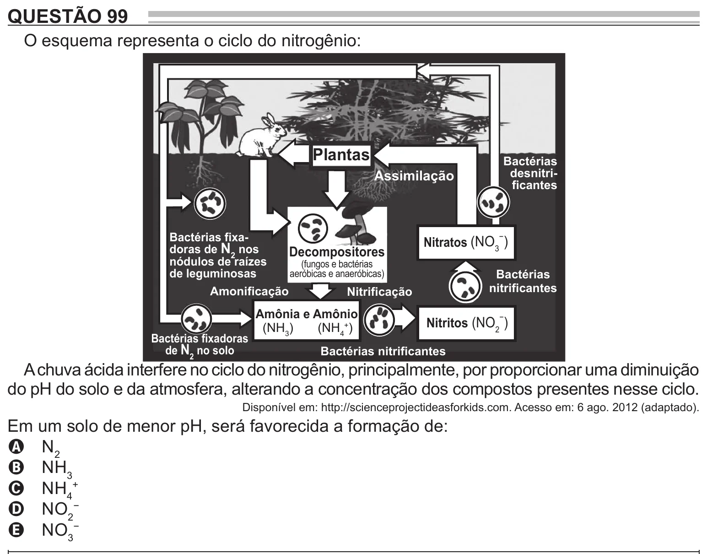

Texto extraído (pode conter ruído)

QUESTÃO 99  
O esquema representa o ciclo do nitrogênio:  
Plantas  
Bactérias  
desnitri-  
Assimilação  
ficantes  
Bactérias fixa-  
Nitratos (NO 3 )  
−  
doras de N 2 nos  
Decompositores  
nódulos de raízes  
(fungos e bactérias  
de leguminosas  
aeróbicas e anaeróbicas)  
Bactérias  
nitrificantes  
Amonificação  
Nitrificação  
Amônia e Amônio  
Nitritos (NO 2 )  
−  
(NH 3 )  
(NH 4+ )  
Bactérias fixadoras  
de N 2 no solo  
Bactérias nitrificantes  
A chuva ácida interfere no ciclo do nitrogênio, principalmente, por proporcionar uma diminuição  
do pH do solo e da atmosfera, alterando a concentração dos compostos presentes nesse ciclo.  
Disponível em: http://scienceprojectideasforkids.com. Acesso em: 6 ago. 2012 (adaptado).  
Em um solo de menor pH, será favorecida a formação de:  
A N 2  
B NH 3  
C NH 4 +  
D NO 2 −  
E NO 3−

