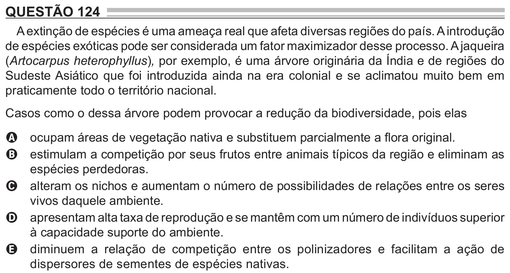

Texto extraído (pode conter ruído)

QUESTÃO 124  
A extinção de espécies é uma ameaça real que afeta diversas regiões do país. A introdução  
de espécies exóticas pode ser considerada um fator maximizador desse processo. A jaqueira  
(Artocarpus heterophyllus), por exemplo, é uma árvore originária da Índia e de regiões do  
Sudeste Asiático que foi introduzida ainda na era colonial e se aclimatou muito bem em  
praticamente todo o território nacional.  
Casos como o dessa árvore podem provocar a redução da biodiversidade, pois elas  
ocupam áreas de vegetação nativa e substituem parcialmente a flora original.  
A  
estimulam a competição por seus frutos entre animais típicos da região e eliminam as  
B  
espécies perdedoras.  
alteram os nichos e aumentam o número de possibilidades de relações entre os seres  
C  
vivos daquele ambiente.  
apresentam alta taxa de reprodução e se mantêm com um número de indivíduos superior  
D  
à capacidade suporte do ambiente.  
diminuem a relação de competição entre os polinizadores e facilitam a ação de  
E  
dispersores de sementes de espécies nativas.

