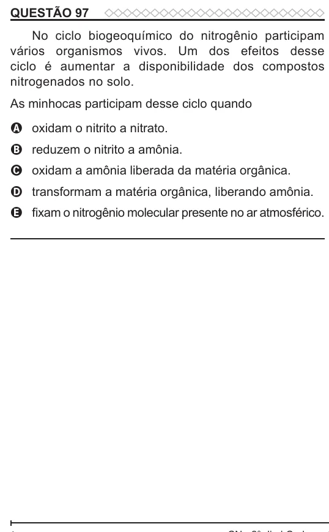

Texto extraído (pode conter ruído)

QUESTÃO 97  
No ciclo biogeoquímico do nitrogênio participam  
vários organismos vivos. Um dos efeitos desse  
ciclo é aumentar a disponibilidade dos compostos  
nitrogenados no solo.  
As minhocas participam desse ciclo quando  
A oxidam o nitrito a nitrato.  
B reduzem o nitrito a amônia.  
C oxidam a amônia liberada da matéria orgânica.  
D transformam a matéria orgânica, liberando amônia.  
E fixam o nitrogênio molecular presente no ar atmosférico.

