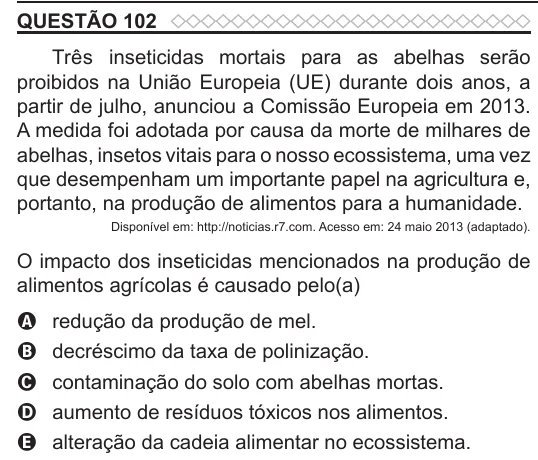

Texto extraído (pode conter ruído)

QUESTÃO 102  
Três inseticidas mortais para as abelhas serão  
proibidos na União Europeia (UE) durante dois anos, a  
partir de julho, anunciou a Comissão Europeia em 2013.  
A medida foi adotada por causa da morte de milhares de  
abelhas, insetos vitais para o nosso ecossistema, uma vez  
que desempenham um importante papel na agricultura e,  
portanto, na produção de alimentos para a humanidade.  
Disponível em: http://noticias.r7.com. Acesso em: 24 maio 2013 (adaptado).  
O impacto dos inseticidas mencionados na produção de  
alimentos agrícolas é causado pelo(a)  
A  
redução da produção de mel.  
B  
decréscimo da taxa de polinização.  
contaminação do solo com abelhas mortas.  
C  
aumento de resíduos tóxicos nos alimentos.  
D  
alteração da cadeia alimentar no ecossistema.  
E

