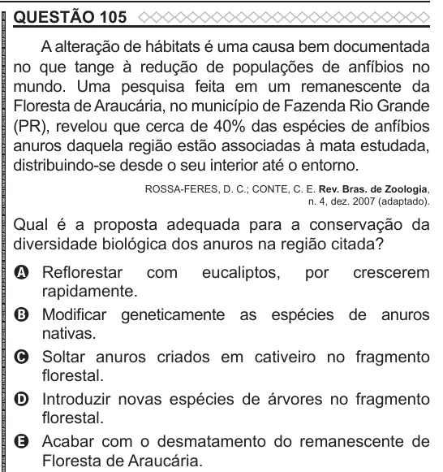

Texto extraído (pode conter ruído)

QUESTÃO 105  
A alteração de hábitats é uma causa bem documentada  
no que tange à redução de populações de anfíbios no  
mundo. Uma pesquisa feita em um remanescente da  
Floresta de Araucária, no município de Fazenda Rio Grande  
(PR), revelou que cerca de 40% das espécies de anfíbios  
anuros daquela região estão associadas à mata estudada,  
distribuindo-se desde o seu interior até o entorno.  
ROSSA-FERES, D. C.; CONTE, C. E. Rev. Bras. de Zoologia,  
n. 4, dez. 2007 (adaptado).  
Qual é a proposta adequada para a conservação da  
diversidade biológica dos anuros na região citada?  
A Reflorestar com eucaliptos, por crescerem  
rapidamente.  
B Modificar geneticamente as espécies de anuros  
nativas.  
C Soltar anuros criados em cativeiro no fragmento  
florestal.  
D Introduzir novas espécies de árvores no fragmento  
florestal.  
E Acabar com o desmatamento do remanescente de  
Floresta de Araucária.

