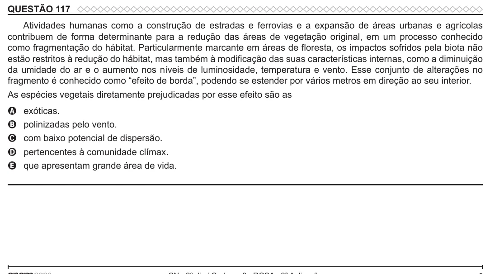

Texto extraído (pode conter ruído)

QUESTÃO 117  
Atividades humanas como a construção de estradas e ferrovias e a expansão de áreas urbanas e agrícolas  
contribuem de forma determinante para a redução das áreas de vegetação original, em um processo conhecido  
como fragmentação do hábitat. Particularmente marcante em áreas de floresta, os impactos sofridos pela biota não  
estão restritos à redução do hábitat, mas também à modificação das suas características internas, como a diminuição  
da umidade do ar e o aumento nos níveis de luminosidade, temperatura e vento. Esse conjunto de alterações no  
fragmento é conhecido como “efeito de borda”, podendo se estender por vários metros em direção ao seu interior.  
As espécies vegetais diretamente prejudicadas por esse efeito são as  
exóticas.  
A  
B  
polinizadas pelo vento.  
com baixo potencial de dispersão.  
C  
pertencentes à comunidade clímax.  
D  
que apresentam grande área de vida.  
E

