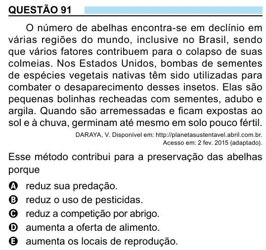

Texto extraído (pode conter ruído)

QUESTÃO 91  
O número de abelhas encontra-se em declínio em  
várias regiões do mundo, inclusive no Brasil, sendo  
que vários fatores contribuem para o colapso de suas  
colmeias. Nos Estados Unidos, bombas de sementes  
de espécies vegetais nativas têm sido utilizadas para  
combater o desaparecimento desses insetos. Elas são  
pequenas bolinhas recheadas com sementes, adubo e  
argila. Quando são arremessadas e ficam expostas ao  
sol e à chuva, germinam até mesmo em solo pouco fértil.  
DARAYA, V. Disponível em: http://planetasustentavel.abril.com.br.  
Acesso em: 2 fev. 2015 (adaptado).  
Esse método contribui para a preservação das abelhas  
porque  
A  
reduz sua predação.  
reduz o uso de pesticidas.  
B  
C  
reduz a competição por abrigo.  
aumenta a oferta de alimento.  
D  
aumenta os locais de reprodução.  
E

