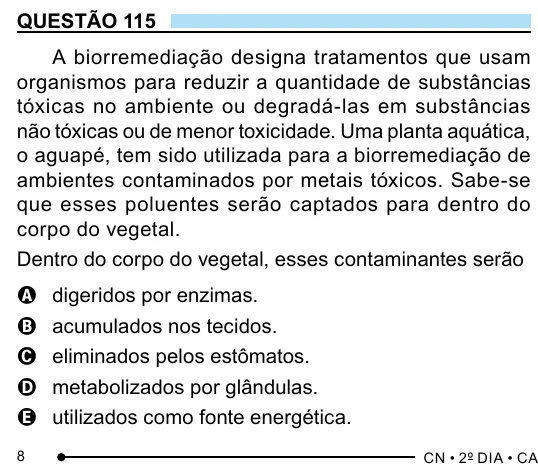

Texto extraído (pode conter ruído)

QUESTÃO 115  
A biorremediação designa tratamentos que usam  
organismos para reduzir a quantidade de substâncias  
tóxicas no ambiente ou degradá-las em substâncias  
não tóxicas ou de menor toxicidade. Uma planta aquática,  
o aguapé, tem sido utilizada para a biorremediação de  
ambientes contaminados por metais tóxicos. Sabe-se  
que esses poluentes serão captados para dentro do  
corpo do vegetal.  
Dentro do corpo do vegetal, esses contaminantes serão  
digeridos por enzimas.  
A  
acumulados nos tecidos.  
B  
eliminados pelos estômatos.  
C  
metabolizados por glândulas.  
D  
utilizados como fonte energética.  
E  
8

