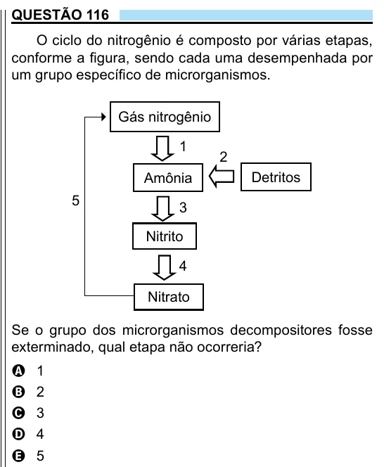

Texto extraído (pode conter ruído)

QUESTÃO 116  
O ciclo do nitrogênio é composto por várias etapas,  
conforme a figura, sendo cada uma desempenhada por  
um grupo específico de microrganismos.  
Gás nitrogênio  
1  
2  
Amônia  
Detritos  
5  
3  
Nitrito  
4  
Nitrato  
Se o grupo dos microrganismos decompositores fosse  
exterminado, qual etapa não ocorreria?  
A  
1  
2  
B  
3  
C  
4  
D  
5  
E

