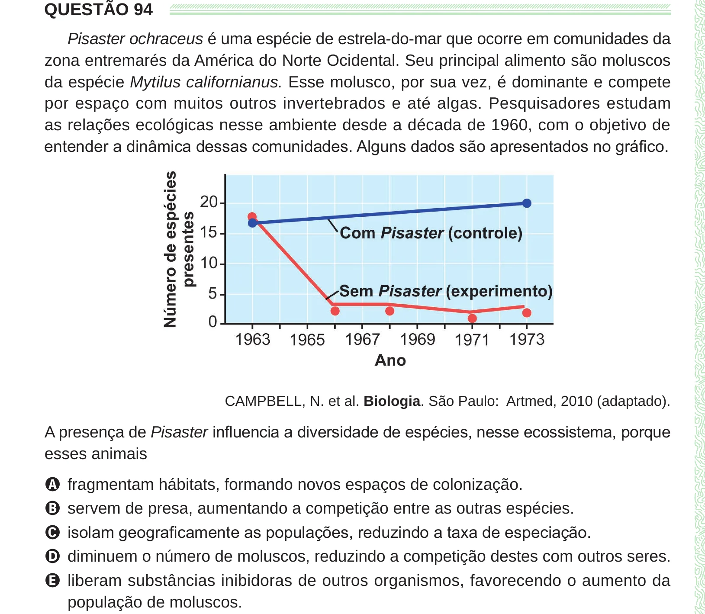

Texto extraído (pode conter ruído)

QUESTÃO 94  
Pisaster ochraceus é uma espécie de estrela-do-mar que ocorre em comunidades da  
zona entremarés da América do Norte Ocidental. Seu principal alimento são moluscos  
da espécie Mytilus californianus. Esse molusco, por sua vez, é dominante e compete  
por espaço com muitos outros invertebrados e até algas. Pesquisadores estudam  
as relações ecológicas nesse ambiente desde a década de 1960, com o objetivo de  
entender a dinâmica dessas comunidades. Alguns dados são apresentados no gráfico.  
CAMPBELL, N. et al. Biologia. São Paulo: Artmed, 2010 (adaptado).  
A presença de Pisaster influencia a diversidade de espécies, nesse ecossistema, porque  
esses animais  
A fragmentam hábitats, formando novos espaços de colonização.  
B servem de presa, aumentando a competição entre as outras espécies.  
C isolam geograficamente as populações, reduzindo a taxa de especiação.  
D diminuem o número de moluscos, reduzindo a competição destes com outros seres.  
E liberam substâncias inibidoras de outros organismos, favorecendo o aumento da  
população de moluscos.

