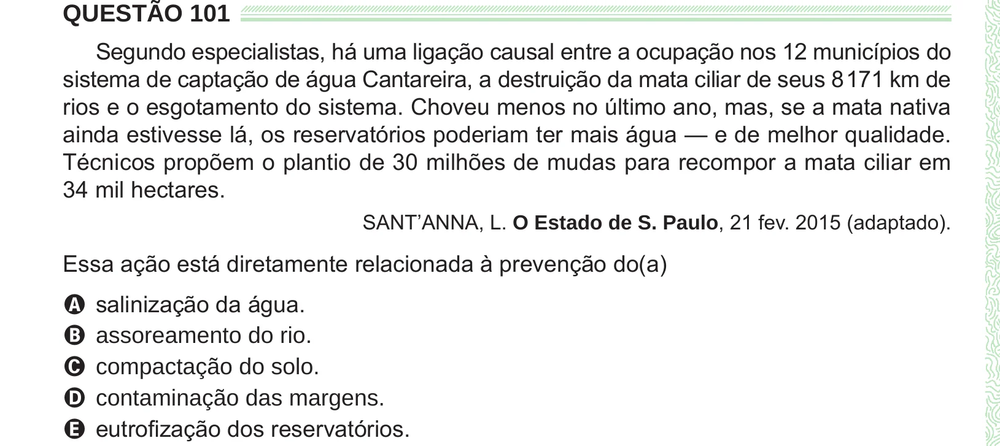

Texto extraído (pode conter ruído)

QUESTÃO 101  
Segundo especialistas, há uma ligação causal entre a ocupação nos 12 municípios do  
sistema de captação de água Cantareira, a destruição da mata ciliar de seus 8 171 km de  
rios e o esgotamento do sistema. Choveu menos no último ano, mas, se a mata nativa  
ainda estivesse lá, os reservatórios poderiam ter mais água — e de melhor qualidade.  
Técnicos propõem o plantio de 30 milhões de mudas para recompor a mata ciliar em  
34 mil hectares.  
SANT’ANNA, L. O Estado de S. Paulo, 21 fev. 2015 (adaptado).  
Essa ação está diretamente relacionada à prevenção do(a)  
A salinização da água.  
B assoreamento do rio.  
C compactação do solo.  
D contaminação das margens.  
E eutrofização dos reservatórios.

