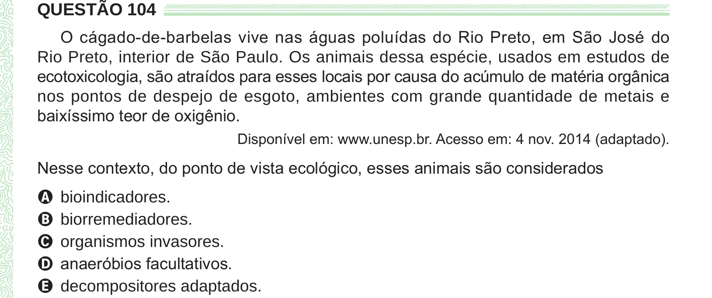

Texto extraído (pode conter ruído)

QUESTÃO 104  
O cágado-de-barbelas vive nas águas poluídas do Rio Preto, em São José do  
Rio Preto, interior de São Paulo. Os animais dessa espécie, usados em estudos de  
ecotoxicologia, são atraídos para esses locais por causa do acúmulo de matéria orgânica  
nos pontos de despejo de esgoto, ambientes com grande quantidade de metais e  
baixíssimo teor de oxigênio.  
Disponível em: www.unesp.br. Acesso em: 4 nov. 2014 (adaptado).  
Nesse contexto, do ponto de vista ecológico, esses animais são considerados  
A bioindicadores.  
B biorremediadores.  
C organismos invasores.  
D anaeróbios facultativos.  
E decompositores adaptados.

