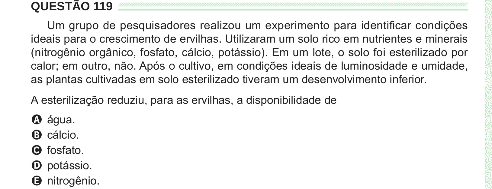

Texto extraído (pode conter ruído)

QUESTÃO 119  
Um grupo de pesquisadores realizou um experimento para identificar condições  
ideais para o crescimento de ervilhas. Utilizaram um solo rico em nutrientes e minerais  
(nitrogênio orgânico, fosfato, cálcio, potássio). Em um lote, o solo foi esterilizado por  
calor; em outro, não. Após o cultivo, em condições ideais de luminosidade e umidade,  
as plantas cultivadas em solo esterilizado tiveram um desenvolvimento inferior.  
A esterilização reduziu, para as ervilhas, a disponibilidade de  
A água.  
B cálcio.  
C fosfato.  
D potássio.  
E nitrogênio.

