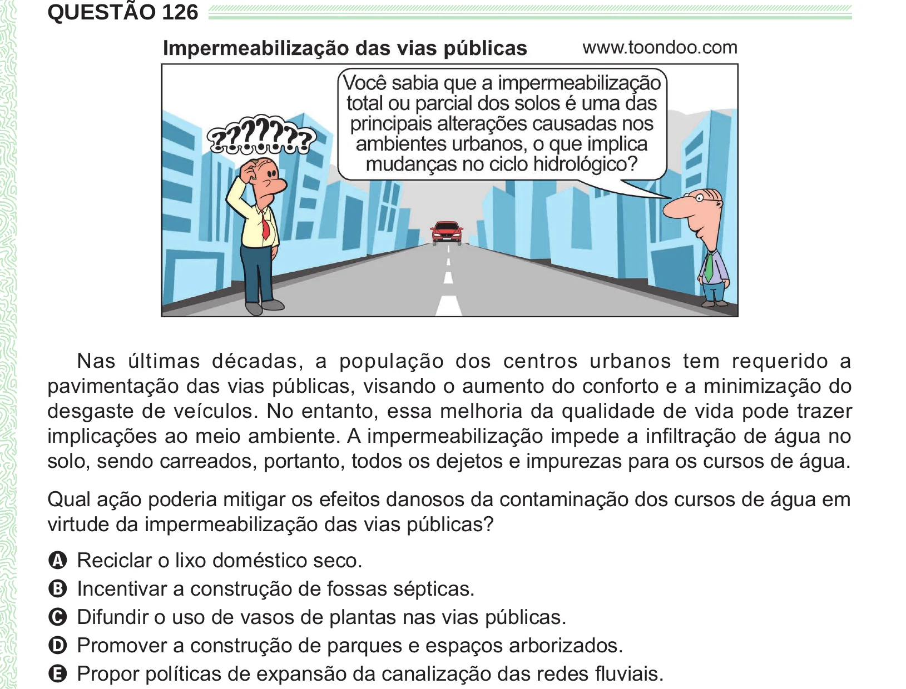

Texto extraído (pode conter ruído)

QUESTÃO 126  
Nas últimas décadas, a população dos centros urbanos tem requerido a  
pavimentação das vias públicas, visando o aumento do conforto e a minimização do  
desgaste de veículos. No entanto, essa melhoria da qualidade de vida pode trazer  
implicações ao meio ambiente. A impermeabilização impede a infiltração de água no  
solo, sendo carreados, portanto, todos os dejetos e impurezas para os cursos de água.  
Qual ação poderia mitigar os efeitos danosos da contaminação dos cursos de água em  
virtude da impermeabilização das vias públicas?  
A Reciclar o lixo doméstico seco.  
B Incentivar a construção de fossas sépticas.  
C Difundir o uso de vasos de plantas nas vias públicas.  
D Promover a construção de parques e espaços arborizados.  
E Propor políticas de expansão da canalização das redes fluviais.

