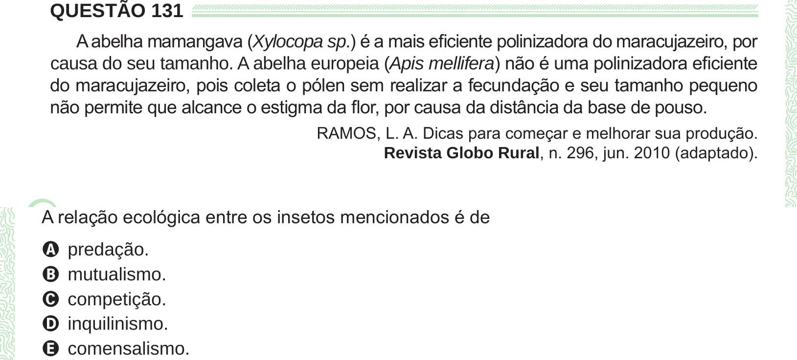

Texto extraído (pode conter ruído)

QUESTÃO 131  
A abelha mamangava (Xylocopa sp.) é a mais eficiente polinizadora do maracujazeiro, por  
causa do seu tamanho. A abelha europeia (Apis mellifera) não é uma polinizadora eficiente  
do maracujazeiro, pois coleta o pólen sem realizar a fecundação e seu tamanho pequeno  
não permite que alcance o estigma da flor, por causa da distância da base de pouso.  
RAMOS, L. A. Dicas para começar e melhorar sua produção.  
Revista Globo Rural, n. 296, jun. 2010 (adaptado).  
A predação.  
B mutualismo.  
C competição.  
D inquilinismo.  
E comensalismo.

