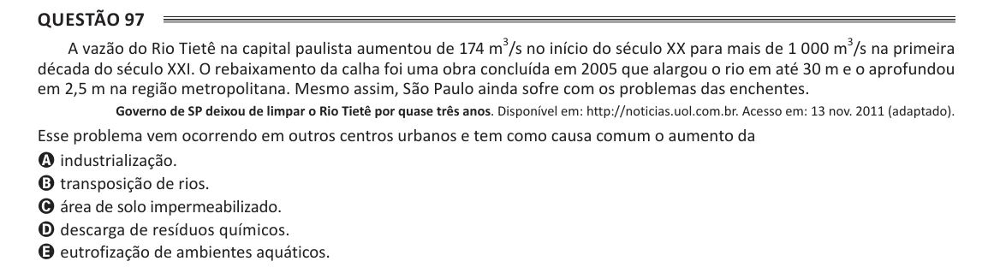

Texto extraído (pode conter ruído)

Questão 97  
A vazão do Rio Tietê na capital paulista aumentou de 174 m 3 /s no início do século XX para mais de 1 000 m 3 /s na primeira  
década do século XXI. O rebaixamento da calha foi uma obra concluída em 2005 que alargou o rio em até 30 m e o aprofundou  
em 2,5 m na região metropolitana. Mesmo assim, São Paulo ainda sofre com os problemas das enchentes.  
Governo de SP deixou de limpar o Rio Tietê por quase três anos. Disponível em: http://noticias.uol.com.br. Acesso em: 13 nov. 2011 (adaptado).  
Esse problema vem ocorrendo em outros centros urbanos e tem como causa comum o aumento da  
A industrialização.  
B transposição de rios.  
C área de solo impermeabilizado.  
D descarga de resíduos químicos.  
E eutrofização de ambientes aquáticos.

