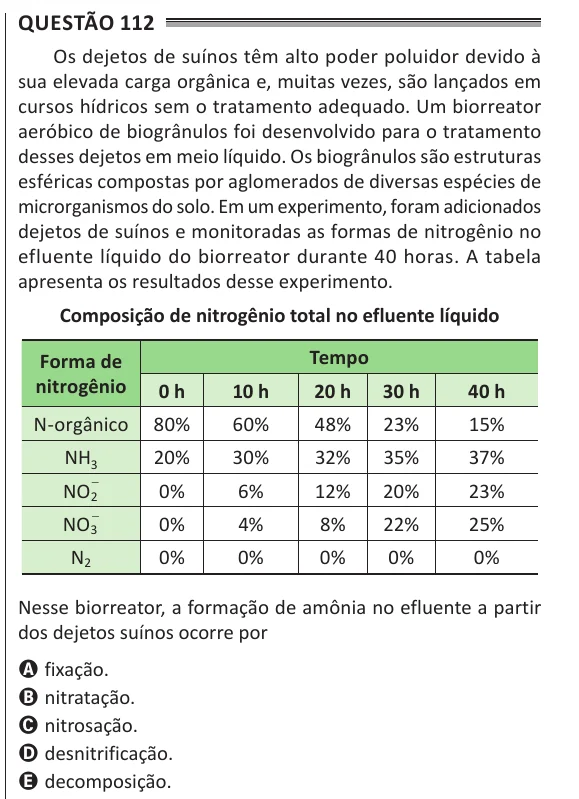

Texto extraído (pode conter ruído)

Questão 112  
Os dejetos de suínos têm alto poder poluidor devido à  
sua elevada carga orgânica e, muitas vezes, são lançados em  
cursos hídricos sem o tratamento adequado. Um biorreator  
aeróbico de biogrânulos foi desenvolvido para o tratamento  
desses dejetos em meio líquido. Os biogrânulos são estruturas  
esféricas compostas por aglomerados de diversas espécies de  
microrganismos do solo. Em um experimento, foram adicionados  
dejetos de suínos e monitoradas as formas de nitrogênio no  
efluente líquido do biorreator durante 40 horas. A tabela  
apresenta os resultados desse experimento.  
Composição de nitrogênio total no efluente líquido  
tempo  
Forma de  
nitrogênio  
0 h  
10 h  
20 h  
30 h  
40 h  
N-orgânico  
80%  
60%  
48%  
23%  
15%  
NH 3  
20%  
30%  
32%  
35%  
37%  
NO 2  
−  
0%  
6%  
12%  
20%  
23%  
−  
NO 3  
0%  
4%  
8%  
22%  
25%  
N 2  
0%  
0%  
0%  
0%  
0%  
Nesse biorreator, a formação de amônia no efluente a partir  
dos dejetos suínos ocorre por  
A fixação.  
B nitratação.  
C nitrosação.  
D desnitrificação.  
E decomposição.

