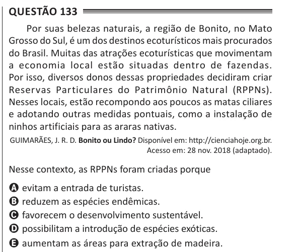

Texto extraído (pode conter ruído)

Questão 133  
Por suas belezas naturais, a região de Bonito, no Mato  
Grosso do Sul, é um dos destinos ecoturísticos mais procurados  
do Brasil. Muitas das atrações ecoturísticas que movimentam  
a economia local estão situadas dentro de fazendas.  
Por isso, diversos donos dessas propriedades decidiram criar  
Reservas Particulares do Patrimônio Natural (RPPNs).  
Nesses locais, estão recompondo aos poucos as matas ciliares  
e adotando outras medidas pontuais, como a instalação de  
ninhos artificiais para as araras nativas.  
GUIMARÃES, J. R. D. Bonito ou Lindo? Disponível em: http://cienciahoje.org.br.  
Acesso em: 28 nov. 2018 (adaptado).  
Nesse contexto, as RPPNs foram criadas porque  
A evitam a entrada de turistas.  
B reduzem as espécies endêmicas.  
C favorecem o desenvolvimento sustentável.  
D possibilitam a introdução de espécies exóticas.  
E aumentam as áreas para extração de madeira.

