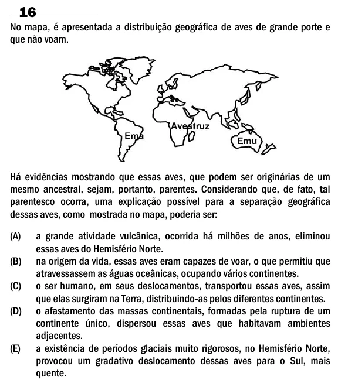

Texto extraído (pode conter ruído)

16  
No mapa, é apresentada a distribuição geográfica de aves de grande porte e  
que não voam.  
Há evidências mostrando que essas aves, que podem ser originárias de um  
mesmo ancestral, sejam, portanto, parentes. Considerando que, de fato, tal  
parentesco ocorra, uma explicação possível para a separação geográfica  
dessas aves, como mostrada no mapa, poderia ser:  
(A)  
a grande atividade vulcânica, ocorrida há milhões de anos, eliminou  
essas aves do Hemisfério Norte.  
(B)  
na origem da vida, essas aves eram capazes de voar, o que permitiu que  
atravessassem as águas oceânicas, ocupando vários continentes.  
(C)  
o ser humano, em seus deslocamentos, transportou essas aves, assim  
que elas surgiram na Terra, distribuindo-as pelos diferentes continentes.  
(D)  
o afastamento das massas continentais, formadas pela ruptura de um  
continente único, dispersou essas aves que habitavam ambientes  
adjacentes.  
(E)  
a existência de períodos glaciais muito rigorosos, no Hemisfério Norte,  
provocou um gradativo deslocamento dessas aves para o Sul, mais  
quente.

