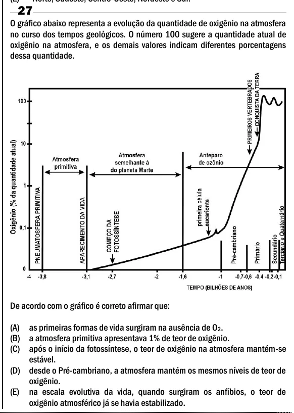

Texto extraído (pode conter ruído)

27  
O gráfico abaixo representa a evolução da quantidade de oxigênio na atmosfera  
no curso dos tempos geológicos. O número 100 sugere a quantidade atual de  
oxigênio na atmosfera, e os demais valores indicam diferentes porcentagens  
dessa quantidade.  
De acordo com o gráfico é correto afirmar que:  
(A) as primeiras formas de vida surgiram na ausência de O 2 .  
(B) a atmosfera primitiva apresentava 1% de teor de oxigênio.  
(C) após o início da fotossíntese, o teor de oxigênio na atmosfera mantém-se  
estável.  
(D) desde o Pré-cambriano, a atmosfera mantém os mesmos níveis de teor de  
oxigênio.  
(E) na escala evolutiva da vida, quando surgiram os anfíbios, o teor de  
oxigênio atmosférico já se havia estabilizado.

