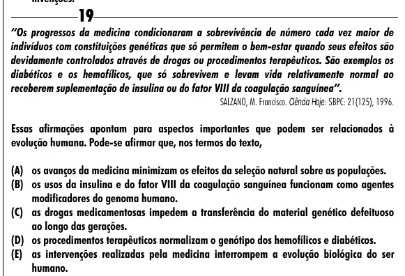

Texto extraído (pode conter ruído)

19  
“Os progressos da medicina condicionaram a sobrevivência de número cada vez maior de  
indivíduos com constituições genéticas que só permitem o bem-estar quando seus efeitos são  
devidamente controlados através de drogas ou procedimentos terapêuticos. São exemplos os  
diabéticos e os hemofílicos, que só sobrevivem e levam vida relativamente normal ao  
receberem suplementação de insulina ou do fator VIII da coagulação sanguínea”.  
SALZANO, M. Francisco. Ciência Hoje: SBPC: 21(125), 1996.  
Essas afirmações apontam para aspectos importantes que podem ser relacionados à  
evolução humana. Pode-se afirmar que, nos termos do texto,  
(A) os avanços da medicina minimizam os efeitos da seleção natural sobre as populações.  
(B) os usos da insulina e do fator VIII da coagulação sanguínea funcionam como agentes  
modificadores do genoma humano.  
(C) as drogas medicamentosas impedem a transferência do material genético defeituoso  
ao longo das gerações.  
(D) os procedimentos terapêuticos normalizam o genótipo dos hemofílicos e diabéticos.  
(E) as intervenções realizadas pela medicina interrompem a evolução biológica do ser  
humano.

