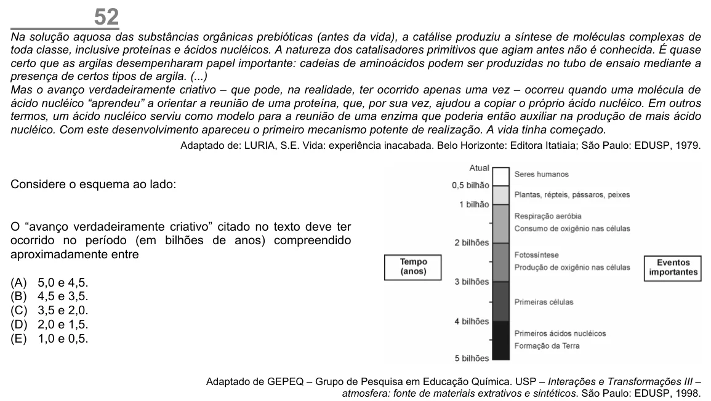

Texto extraído (pode conter ruído)

52  
Na solução aquosa das substâncias orgânicas prebióticas (antes da vida), a catálise produziu a síntese de moléculas complexas de  
toda classe, inclusive proteínas e ácidos nucléicos. A natureza dos catalisadores primitivos que agiam antes não é conhecida. É quase  
certo que as argilas desempenharam papel importante: cadeias de aminoácidos podem ser produzidas no tubo de ensaio mediante a  
presença de certos tipos de argila. (...)  
Mas o avanço verdadeiramente criativo – que pode, na realidade, ter ocorrido apenas uma vez – ocorreu quando uma molécula de  
ácido nucléico “aprendeu” a orientar a reunião de uma proteína, que, por sua vez, ajudou a copiar o próprio ácido nucléico. Em outros  
termos, um ácido nucléico serviu como modelo para a reunião de uma enzima que poderia então auxiliar na produção de mais ácido  
nucléico. Com este desenvolvimento apareceu o primeiro mecanismo potente de realização. A vida tinha começado.  
Adaptado de: LURIA, S.E. Vida: experiência inacabada. Belo Horizonte: Editora Itatiaia; São Paulo: EDUSP, 1979.  
Considere o esquema ao lado:  
O “avanço verdadeiramente criativo” citado no texto deve ter  
ocorrido no período (em bilhões de anos) compreendido  
aproximadamente entre  
(A)  
5,0 e 4,5.  
(B)  
4,5 e 3,5.  
(C)  
3,5 e 2,0.  
(D)  
2,0 e 1,5.  
(E)  
1,0 e 0,5.  
Adaptado de GEPEQ – Grupo de Pesquisa em Educação Química. USP – Interações e Transformações III –  
atmosfera: fonte de materiais extrativos e sintéticos. São Paulo: EDUSP, 1998.

