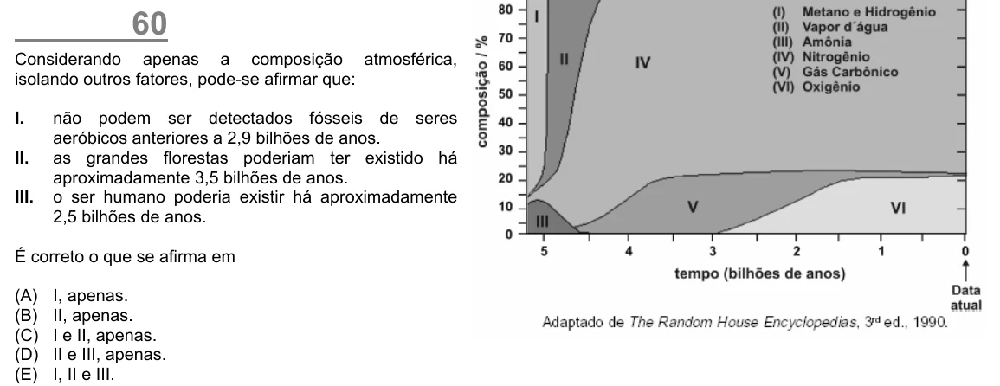

Texto extraído (pode conter ruído)

60  
Considerando apenas a composição atmosférica,  
isolando outros fatores, pode-se afirmar que:  
I.  
não podem ser detectados fósseis de seres  
aeróbicos anteriores a 2,9 bilhões de anos.  
II.  
as grandes florestas poderiam ter existido há  
aproximadamente 3,5 bilhões de anos.  
III.  
o ser humano poderia existir há aproximadamente  
2,5 bilhões de anos.  
É correto o que se afirma em  
(A)  
I, apenas.  
(B)  
II, apenas.  
(C)  
I e II, apenas.  
(D)  
II e III, apenas.  
(E)  
I, II e III.

