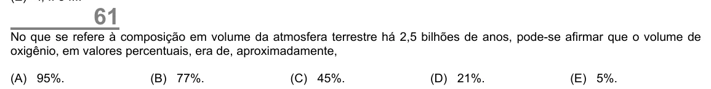

Texto extraído (pode conter ruído)

61  
No que se refere à composição em volume da atmosfera terrestre há 2,5 bilhões de anos, pode-se afirmar que o volume de  
oxigênio, em valores percentuais, era de, aproximadamente,  
(A) 95%.  
(B) 77%.  
(C) 45%.  
(D) 21%.  
(E) 5%.

