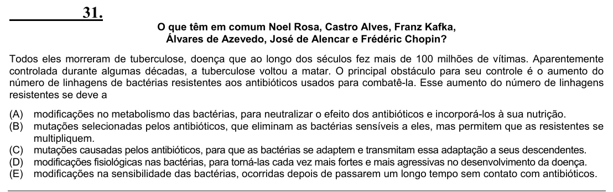

Texto extraído (pode conter ruído)

31.  
O que têm em comum Noel Rosa, Castro Alves, Franz Kafka,  
Álvares de Azevedo, José de Alencar e Frédéric Chopin?  
Todos eles morreram de tuberculose, doença que ao longo dos séculos fez mais de 100 milhões de vítimas. Aparentemente  
controlada durante algumas décadas, a tuberculose voltou a matar. O principal obstáculo para seu controle é o aumento do  
número de linhagens de bactérias resistentes aos antibióticos usados para combatê-la. Esse aumento do número de linhagens  
resistentes se deve a  
(A)  
modificações no metabolismo das bactérias, para neutralizar o efeito dos antibióticos e incorporá-los à sua nutrição.  
(B)  
mutações selecionadas pelos antibióticos, que eliminam as bactérias sensíveis a eles, mas permitem que as resistentes se  
multipliquem.  
(C)  
mutações causadas pelos antibióticos, para que as bactérias se adaptem e transmitam essa adaptação a seus descendentes.  
(D)  
modificações fisiológicas nas bactérias, para torná-las cada vez mais fortes e mais agressivas no desenvolvimento da doença.  
(E)  
modificações na sensibilidade das bactérias, ocorridas depois de passarem um longo tempo sem contato com antibióticos.

