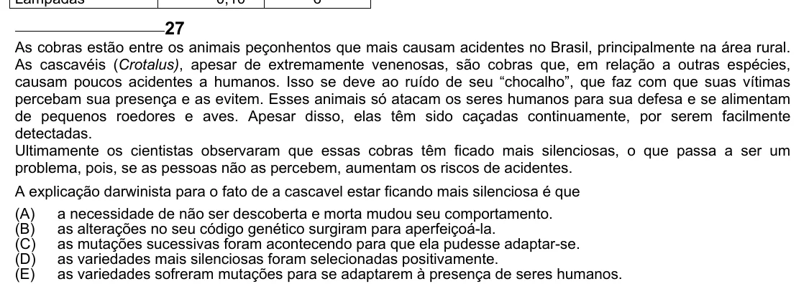

Texto extraído (pode conter ruído)

27  
As cobras estão entre os animais peçonhentos que mais causam acidentes no Brasil, principalmente na área rural.  
As cascavéis (Crotalus), apesar de extremamente venenosas, são cobras que, em relação a outras espécies,  
causam poucos acidentes a humanos. Isso se deve ao ruído de seu “chocalho”, que faz com que suas vítimas  
percebam sua presença e as evitem. Esses animais só atacam os seres humanos para sua defesa e se alimentam  
de pequenos roedores e aves. Apesar disso, elas têm sido caçadas continuamente, por serem facilmente  
detectadas.  
Ultimamente os cientistas observaram que essas cobras têm ficado mais silenciosas, o que passa a ser um  
problema, pois, se as pessoas não as percebem, aumentam os riscos de acidentes.  
A explicação darwinista para o fato de a cascavel estar ficando mais silenciosa é que  
(A)  
a necessidade de não ser descoberta e morta mudou seu comportamento.  
(B)  
as alterações no seu código genético surgiram para aperfeiçoá-la.  
(C) as mutações sucessivas foram acontecendo para que ela pudesse adaptar-se.  
(D) as variedades mais silenciosas foram selecionadas positivamente.  
(E)  
as variedades sofreram mutações para se adaptarem à presença de seres humanos.

