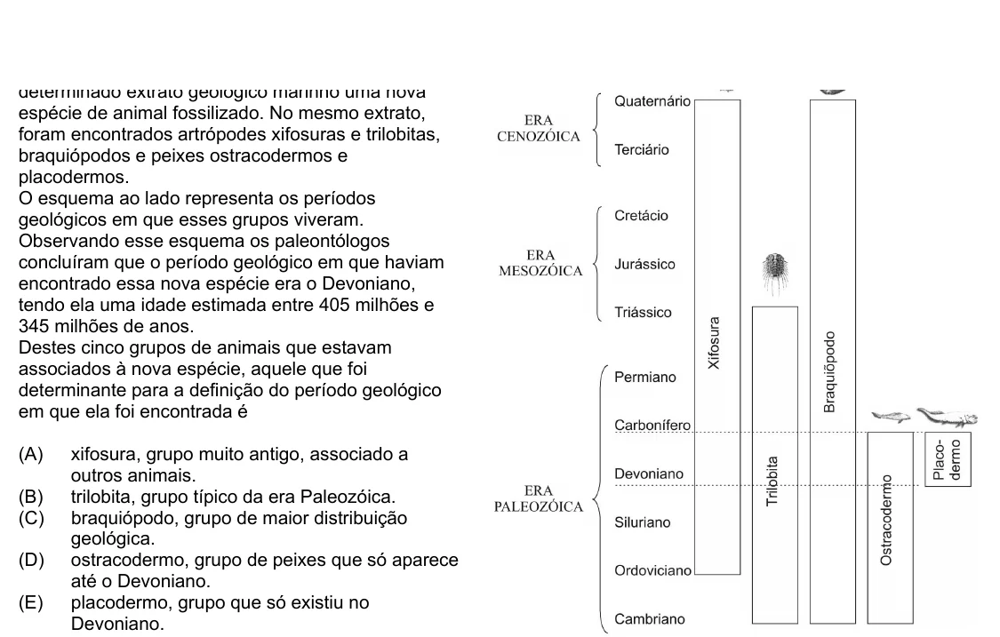

Texto extraído (pode conter ruído)

espécie de animal fossilizado. No mesmo extrato,  
foram encontrados artrópodes xifosuras e trilobitas,  
braquiópodos e peixes ostracodermos e  
placodermos.  
O esquema ao lado representa os períodos  
geológicos em que esses grupos viveram.  
Observando esse esquema os paleontólogos  
concluíram que o período geológico em que haviam  
encontrado essa nova espécie era o Devoniano,  
tendo ela uma idade estimada entre 405 milhões e  
345 milhões de anos.  
Destes cinco grupos de animais que estavam  
associados à nova espécie, aquele que foi  
determinante para a definição do período geológico  
em que ela foi encontrada é  
(A)  
xifosura, grupo muito antigo, associado a  
outros animais.  
(B)  
trilobita, grupo típico da era Paleozóica.  
(C)  
braquiópodo, grupo de maior distribuição  
geológica.  
(D)  
ostracodermo, grupo de peixes que só aparece  
até o Devoniano.  
(E)  
placodermo, grupo que só existiu no  
Devoniano.

