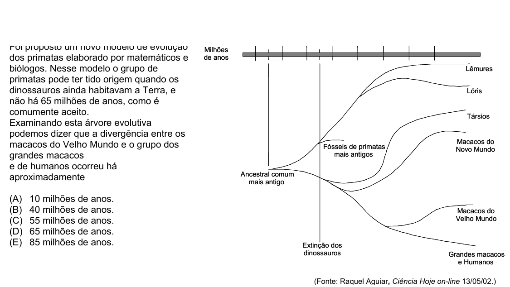

Texto extraído (pode conter ruído)

Milhões  
dos primatas elaborado por matemáticos e  
de anos  
biólogos. Nesse modelo o grupo de  
Lêmures  
primatas pode ter tido origem quando os  
dinossauros ainda habitavam a Terra, e  
Lóris  
não há 65 milhões de anos, como é  
comumente aceito.  
Társios  
Examinando esta árvore evolutiva  
podemos dizer que a divergência entre os  
macacos do Velho Mundo e o grupo dos  
Macacos do  
Fósseis de primatas  
Novo Mundo  
grandes macacos  
mais antigos  
e de humanos ocorreu há  
Ancestral comum  
aproximadamente  
mais antigo  
(A)  
10 milhões de anos.  
(B)  
40 milhões de anos.  
Macacos do  
(C)  
55 milhões de anos.  
Velho Mundo  
(D)  
65 milhões de anos.  
(E)  
85 milhões de anos.  
Extinção dos  
dinossauros  
Grandes macacos  
e Humanos  
(Fonte: Raquel Aguiar, Ciência Hoje on-line 13/05/02.)

