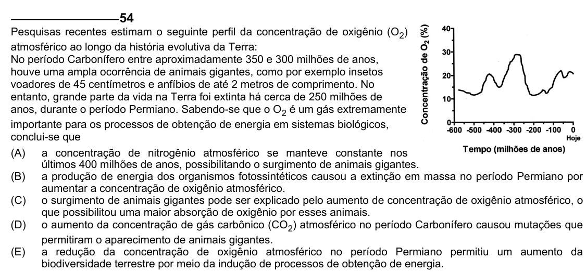

Texto extraído (pode conter ruído)

54  
Pesquisas recentes estimam o seguinte perfil da concentração de oxigênio (O 2 )  
atmosférico ao longo da história evolutiva da Terra:  
No período Carbonífero entre aproximadamente 350 e 300 milhões de anos,  
houve uma ampla ocorrência de animais gigantes, como por exemplo insetos  
voadores de 45 centímetros e anfíbios de até 2 metros de comprimento. No  
entanto, grande parte da vida na Terra foi extinta há cerca de 250 milhões de  
anos, durante o período Permiano. Sabendo-se que o O 2 é um gás extremamente  
importante para os processos de obtenção de energia em sistemas biológicos,  
conclui-se que  
(A)  
a concentração de nitrogênio atmosférico se manteve constante nos  
últimos 400 milhões de anos, possibilitando o surgimento de animais gigantes.  
(B)  
a produção de energia dos organismos fotossintéticos causou a extinção em massa no período Permiano por  
aumentar a concentração de oxigênio atmosférico.  
(C) o surgimento de animais gigantes pode ser explicado pelo aumento de concentração de oxigênio atmosférico, o  
que possibilitou uma maior absorção de oxigênio por esses animais.  
(D) o aumento da concentração de gás carbônico (CO 2 ) atmosférico no período Carbonífero causou mutações que  
permitiram o aparecimento de animais gigantes.  
(E)  
a redução da concentração de oxigênio atmosférico no período Permiano permitiu um aumento da  
biodiversidade terrestre por meio da indução de processos de obtenção de energia.

