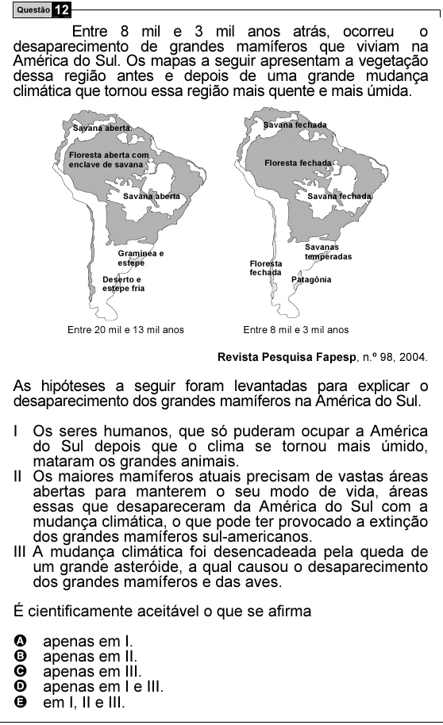

Texto extraído (pode conter ruído)

Questão 12  
Entre 8 mil e 3 mil anos atrás, ocorreu  
o  
desaparecimento de grandes mamíferos que viviam na  
América do Sul. Os mapas a seguir apresentam a vegetação  
dessa região antes e depois de uma grande mudança  
climática que tornou essa região mais quente e mais úmida.  
Savana fechada  
Savana aberta  
Floresta aberta com  
enclave de savana  
Floresta fechada  
Savana aberta  
Savana fechada  
Savanas  
Gramínea e  
temperadas  
estepe  
Floresta  
fechada  
Deserto e  
Patagônia  
estepe fria  
Entre 20 mil e 13 mil anos  
Entre 8 mil e 3 mil anos  
Revista Pesquisa Fapesp, n.º 98, 2004.  
As hipóteses a seguir foram levantadas para explicar o  
desaparecimento dos grandes mamíferos na América do Sul.  
I Os seres humanos, que só puderam ocupar a América  
do Sul depois que o clima se tornou mais úmido,  
mataram os grandes animais.  
II Os maiores mamíferos atuais precisam de vastas áreas  
abertas para manterem o seu modo de vida, áreas  
essas que desapareceram da América do Sul com a  
mudança climática, o que pode ter provocado a extinção  
dos grandes mamíferos sul-americanos.  
III A mudança climática foi desencadeada pela queda de  
um grande asteróide, a qual causou o desaparecimento  
dos grandes mamíferos e das aves.  
É cientificamente aceitável o que se afirma  
A  
apenas em I.  
B  
apenas em II.  
C  
apenas em III.  
D  
apenas em I e III.  
E  
em I, II e III.

