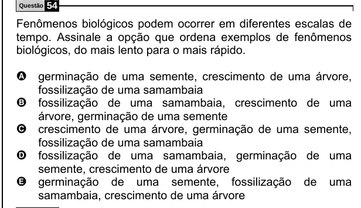

Texto extraído (pode conter ruído)

Questão  
54  
Fenômenos biológicos podem ocorrer em diferentes escalas de  
tempo. Assinale a opção que ordena exemplos de fenômenos  
biológicos, do mais lento para o mais rápido.  
A germinação de uma semente, crescimento de uma árvore,  
fossilização de uma samambaia  
B fossilização de uma samambaia, crescimento de uma  
árvore, germinação de uma semente  
C crescimento de uma árvore, germinação de uma semente,  
fossilização de uma samambaia  
D fossilização de uma samambaia, germinação de uma  
semente, crescimento de uma árvore  
E germinação  
de uma semente, fossilização  
de  
uma  
samambaia, crescimento de uma árvore

