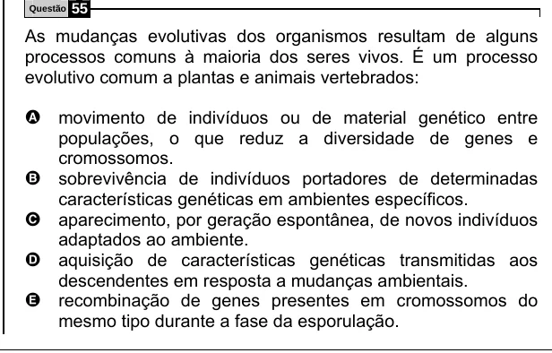

Texto extraído (pode conter ruído)

Questão  
55  
As mudanças evolutivas dos organismos resultam de alguns  
processos comuns à maioria dos seres vivos. É um processo  
evolutivo comum a plantas e animais vertebrados:  
A movimento de indivíduos ou de material genético entre  
populações, o que reduz a diversidade de genes e  
cromossomos.  
sobrevivência de indivíduos portadores de determinadas  
B  
características genéticas em ambientes específicos.  
aparecimento, por geração espontânea, de novos indivíduos  
C  
adaptados ao ambiente.  
D  
aquisição de características genéticas transmitidas aos  
descendentes em resposta a mudanças ambientais.  
E  
recombinação de genes presentes em cromossomos do  
mesmo tipo durante a fase da esporulação.

