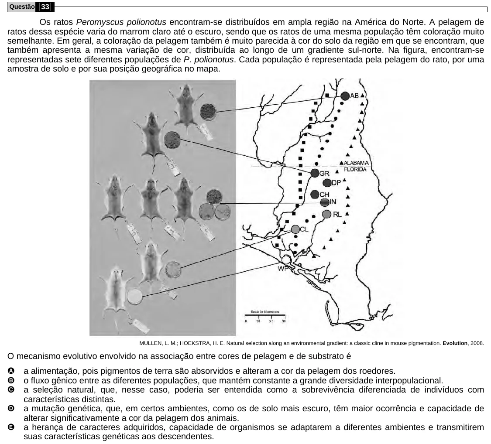

Texto extraído (pode conter ruído)

Questão 33  
Os ratos Peromyscus polionotus encontram-se distribuídos em ampla região na América do Norte. A pelagem de  
ratos dessa espécie varia do marrom claro até o escuro, sendo que os ratos de uma mesma população têm coloração muito  
semelhante. Em geral, a coloração da pelagem também é muito parecida à cor do solo da região em que se encontram, que  
também apresenta a mesma variação de cor, distribuída ao longo de um gradiente sul-norte. Na figura, encontram-se  
representadas sete diferentes populações de P. polionotus. Cada população é representada pela pelagem do rato, por uma  
amostra de solo e por sua posição geográfica no mapa.  
MULLEN, L. M.; HOEKSTRA, H. E. Natural selection along an environmental gradient: a classic cline in mouse pigmentation. Evolution, 2008.  
O mecanismo evolutivo envolvido na associação entre cores de pelagem e de substrato é  
A  
a alimentação, pois pigmentos de terra são absorvidos e alteram a cor da pelagem dos roedores.  
B  
o fluxo gênico entre as diferentes populações, que mantém constante a grande diversidade interpopulacional.  
C  
a seleção natural, que, nesse caso, poderia ser entendida como a sobrevivência diferenciada de indivíduos com  
características distintas.  
D  
a mutação genética, que, em certos ambientes, como os de solo mais escuro, têm maior ocorrência e capacidade de  
alterar significativamente a cor da pelagem dos animais.  
E  
a herança de caracteres adquiridos, capacidade de organismos se adaptarem a diferentes ambientes e transmitirem  
suas características genéticas aos descendentes.

