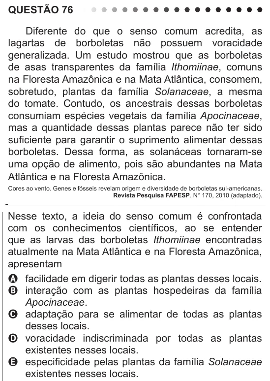

Texto extraído (pode conter ruído)

QUESTÃO 76  
Diferente do que o senso comum acredita, as  
lagartas de borboletas não possuem voracidade  
generalizada. Um estudo mostrou que as borboletas  
de asas transparentes da família Ithomiinae, comuns  
na Floresta Amazônica e na Mata Atlântica, consomem,  
sobretudo, plantas da família Solanaceae, a mesma  
do tomate. Contudo, os ancestrais dessas borboletas  
consumiam espécies vegetais da família Apocinaceae,  
mas a quantidade dessas plantas parece não ter sido  
suficiente para garantir o suprimento alimentar dessas  
borboletas. Dessa forma, as solanáceas tornaram-se  
uma opção de alimento, pois são abundantes na Mata  
Atlântica e na Floresta Amazônica.  
Cores ao vento. Genes e fósseis revelam origem e diversidade de borboletas sul-americanas.  
Revista Pesquisa FAPESP. N° 170, 2010 (adaptado).  
Nesse texto, a ideia do senso comum é confrontada  
com os conhecimentos científicos, ao se entender  
que as larvas das borboletas Ithomiinae encontradas  
atualmente na Mata Atlântica e na Floresta Amazônica,  
apresentam  
A facilidade em digerir todas as plantas desses locais.  
B interação com as plantas hospedeiras da família  
Apocinaceae.  
C adaptação para se alimentar de todas as plantas  
desses locais.  
D voracidade indiscriminada por todas as plantas  
existentes nesses locais.  
E especificidade pelas plantas da família Solanaceae  
existentes nesses locais.

