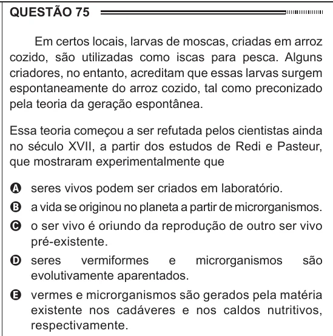

Texto extraído (pode conter ruído)

QUESTÃO 75  
Em certos locais, larvas de moscas, criadas em arroz  
cozido, são utilizadas como iscas para pesca. Alguns  
criadores, no entanto, acreditam que essas larvas surgem  
espontaneamente do arroz cozido, tal como preconizado  
pela teoria da geração espontânea.  
Essa teoria começou a ser refutada pelos cientistas ainda  
no século XVII, a partir dos estudos de Redi e Pasteur,  
que mostraram experimentalmente que  
A seres vivos podem ser criados em laboratório.  
B a vida se originou no planeta a partir de microrganismos.  
C o ser vivo é oriundo da reprodução de outro ser vivo  
pré-existente.  
D seres  
vermiformes  
e  
microrganismos  
são  
evolutivamente aparentados.  
E vermes e microrganismos são gerados pela matéria  
existente nos cadáveres e nos caldos nutritivos,  
respectivamente.

