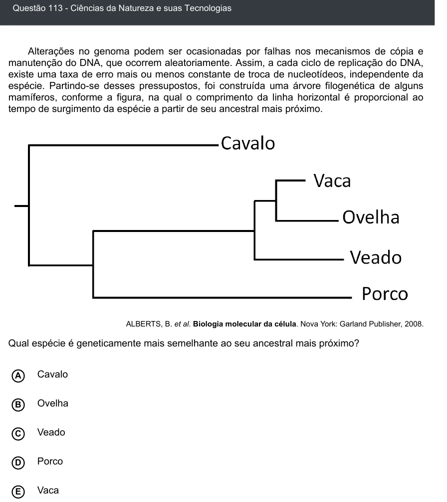

Texto extraído (pode conter ruído)

Questão 113 - Ciências da Natureza e suas Tecnologias  
Alterações no genoma podem ser ocasionadas por falhas nos mecanismos de cópia e  
manutenção do DNA, que ocorrem aleatoriamente. Assim, a cada ciclo de replicação do DNA,  
existe uma taxa de erro mais ou menos constante de troca de nucleotídeos, independente da  
espécie. Partindo-se desses pressupostos, foi construída uma árvore filogenética de alguns  
mamíferos, conforme a figura, na qual o comprimento da linha horizontal é proporcional ao  
tempo de surgimento da espécie a partir de seu ancestral mais próximo.  
ALBERTS, B. et al. Biologia molecular da célula. Nova York: Garland Publisher, 2008.  
Qual espécie é geneticamente mais semelhante ao seu ancestral mais próximo?  
Cavalo  
A  
Ovelha  
B  
C  
Veado  
Porco  
D  
Vaca  
E

