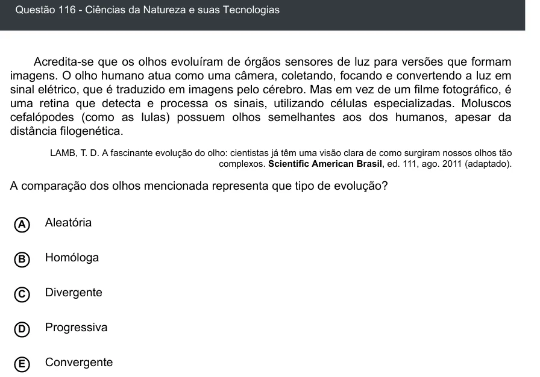

Texto extraído (pode conter ruído)

Questão 116 - Ciências da Natureza e suas Tecnologias  
Acredita-se que os olhos evoluíram de órgãos sensores de luz para versões que formam  
imagens. O olho humano atua como uma câmera, coletando, focando e convertendo a luz em  
sinal elétrico, que é traduzido em imagens pelo cérebro. Mas em vez de um filme fotográfico, é  
uma retina que detecta e processa os sinais, utilizando células especializadas. Moluscos  
cefalópodes (como as lulas) possuem olhos semelhantes aos dos humanos, apesar da  
distância filogenética.  
LAMB, T. D. A fascinante evolução do olho: cientistas já têm uma visão clara de como surgiram nossos olhos tão  
complexos. Scientific American Brasil, ed. 111, ago. 2011 (adaptado).  
A comparação dos olhos mencionada representa que tipo de evolução?  
A  
Aleatória  
B  
Homóloga  
Divergente  
C  
Progressiva  
D  
E  
Convergente

