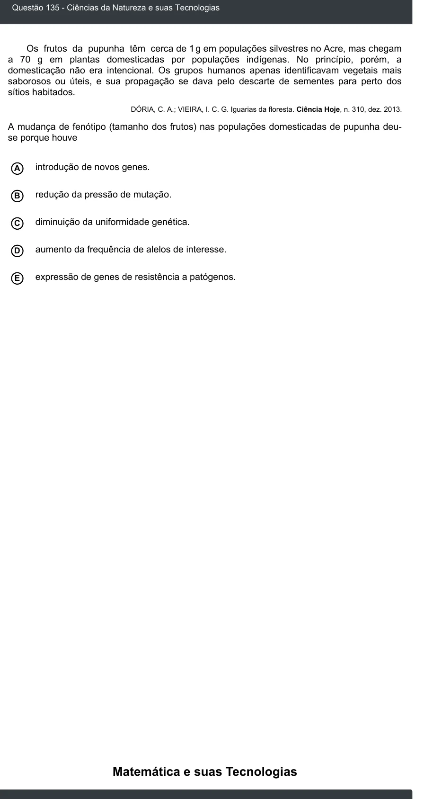

Texto extraído (pode conter ruído)

Questão 135 - Ciências da Natureza e suas Tecnologias  
Os frutos da pupunha têm cerca de 1 g em populações silvestres no Acre, mas chegam  
a 70 g em plantas domesticadas por populações indígenas. No princípio, porém, a  
domesticação não era intencional. Os grupos humanos apenas identificavam vegetais mais  
saborosos ou úteis, e sua propagação se dava pelo descarte de sementes para perto dos  
sítios habitados.  
DÓRIA, C. A.; VIEIRA, I. C. G. Iguarias da floresta. Ciência Hoje, n. 310, dez. 2013.  
A mudança de fenótipo (tamanho dos frutos) nas populações domesticadas de pupunha deu-  
se porque houve  
A  
introdução de novos genes.  
redução da pressão de mutação.  
B  
diminuição da uniformidade genética.  
C  
D  
aumento da frequência de alelos de interesse.  
expressão de genes de resistência a patógenos.  
E  
Matemática e suas Tecnologias

