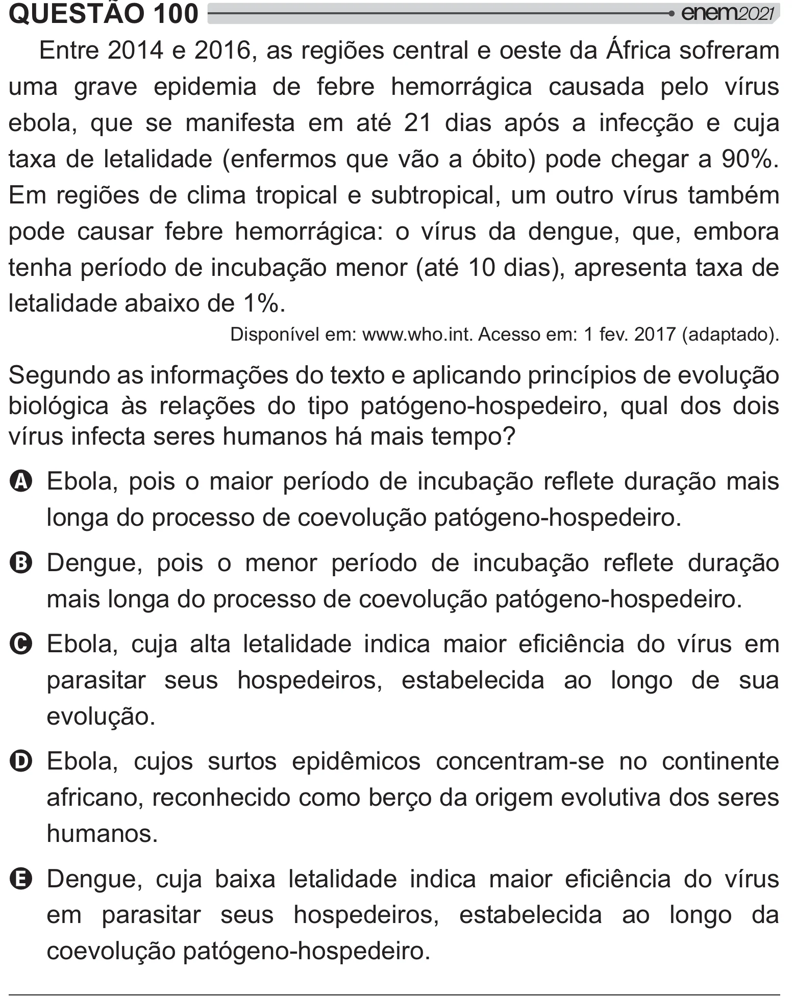

Texto extraído (pode conter ruído)

QUESTÃO 100  
Entre 2014 e 2016, as regiões central e oeste da África sofreram  
uma grave epidemia de febre hemorrágica causada pelo vírus  
ebola, que se manifesta em até 21 dias após a infecção e cuja  
taxa de letalidade (enfermos que vão a óbito) pode chegar a 90%.  
Em regiões de clima tropical e subtropical, um outro vírus também  
pode causar febre hemorrágica: o vírus da dengue, que, embora  
tenha período de incubação menor (até 10 dias), apresenta taxa de  
letalidade abaixo de 1%.  
Disponível em: www.who.int. Acesso em: 1 fev. 2017 (adaptado).  
Segundo as informações do texto e aplicando princípios de evolução  
biológica às relações do tipo patógeno-hospedeiro, qual dos dois  
"{ >    $  $/  #]  
A y #    # {    y=[  }   =[    
longa do processo de coevolução patógeno-hospedeiro.  
B %   #     # {    y=[  }   =[  
mais longa do processo de coevolução patógeno-hospedeiro.  
C y  ‡        +  "{    
parasitar seus hospedeiros, estabelecida ao longo de sua  
evolução.  
D Ebola, cujos surtos epidêmicos concentram-se no continente  
africano, reconhecido como berço da origem evolutiva dos seres  
humanos.  
E %    ‡ y*      +  "{   
em parasitar seus hospedeiros, estabelecida ao longo da  
coevolução patógeno-hospedeiro.

