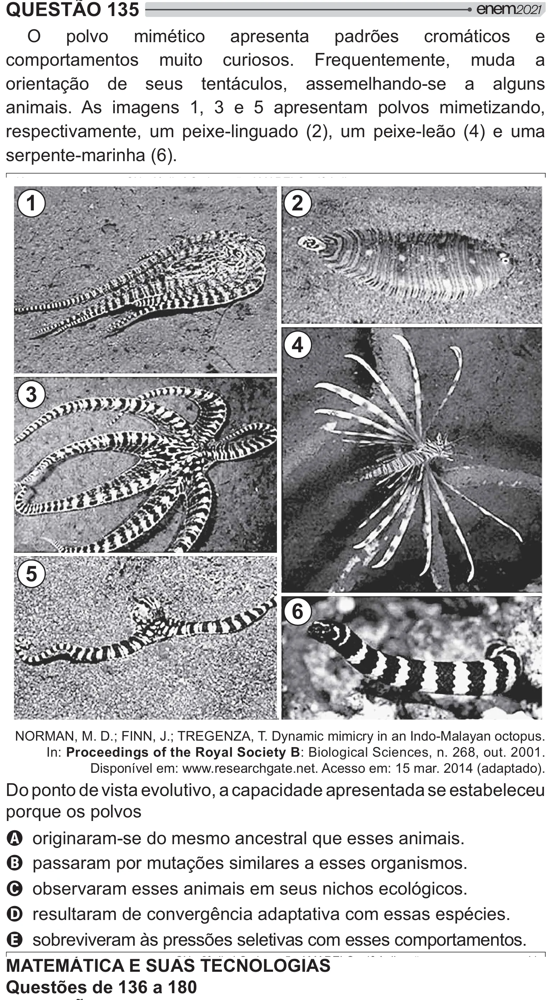

Texto extraído (pode conter ruído)

QUESTÃO 135  
O polvo mimético apresenta padrões cromáticos e  
comportamentos muito curiosos. Frequentemente, muda a  
orientação de seus tentáculos, assemelhando-se a alguns  
animais. As imagens 1, 3 e 5 apresentam polvos mimetizando,  
respectivamente, um peixe-linguado (2), um peixe-leão (4) e uma  
serpente-marinha (6).  
1  
2  
4  
3  
5  
6  
NORMAN, M. D.; FINN, J.; TREGENZA, T. Dynamic mimicry in an Indo-Malayan octopus.  
In: Proceedings of the Royal Society B: Biological Sciences, n. 268, out. 2001.  
Disponível em: www.researchgate.net. Acesso em: 15 mar. 2014 (adaptado).  
Do ponto de vista evolutivo, a capacidade apresentada se estabeleceu  
porque os polvos  
A originaram-se do mesmo ancestral que esses animais.  
B passaram por mutações similares a esses organismos.  
C observaram esses animais em seus nichos ecológicos.  
D resultaram de convergência adaptativa com essas espécies.  
E sobreviveram às pressões seletivas com esses comportamentos.  
MATEMÁTICA E SUAS TECNOLOGIAS  
Questões de 136 a 180

