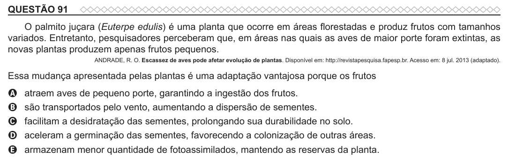

Texto extraído (pode conter ruído)

QUESTÃO 91  
O palmito juçara (Euterpe edulis) é uma planta que ocorre em áreas florestadas e produz frutos com tamanhos  
variados. Entretanto, pesquisadores perceberam que, em áreas nas quais as aves de maior porte foram extintas, as  
novas plantas produzem apenas frutos pequenos.  
ANDRADE, R. O. Escassez de aves pode afetar evolução de plantas. Disponível em: http://revistapesquisa.fapesp.br. Acesso em: 8 jul. 2013 (adaptado).  
Essa mudança apresentada pelas plantas é uma adaptação vantajosa porque os frutos  
atraem aves de pequeno porte, garantindo a ingestão dos frutos.  
A  
são transportados pelo vento, aumentando a dispersão de sementes.  
B  
C  
facilitam a desidratação das sementes, prolongando sua durabilidade no solo.  
aceleram a germinação das sementes, favorecendo a colonização de outras áreas.  
D  
armazenam menor quantidade de fotoassimilados, mantendo as reservas da planta.  
E

