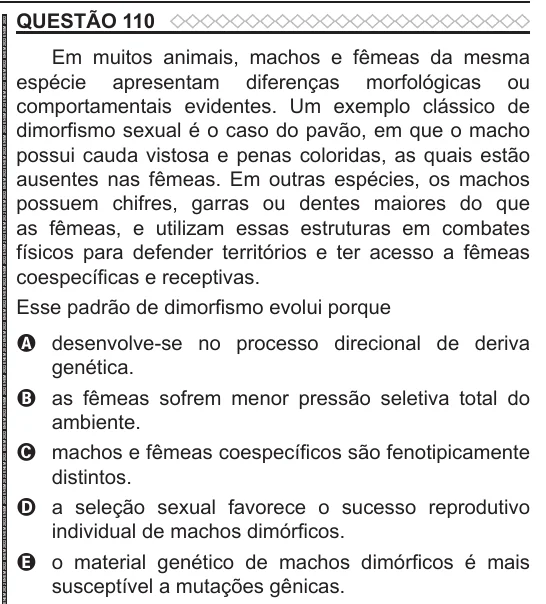

Texto extraído (pode conter ruído)

QUESTÃO 110  
Em muitos animais, machos e fêmeas da mesma  
espécie apresentam diferenças morfológicas ou  
comportamentais evidentes. Um exemplo clássico de  
dimorfismo sexual é o caso do pavão, em que o macho  
possui cauda vistosa e penas coloridas, as quais estão  
ausentes nas fêmeas. Em outras espécies, os machos  
possuem chifres, garras ou dentes maiores do que  
as fêmeas, e utilizam essas estruturas em combates  
físicos para defender territórios e ter acesso a fêmeas  
coespecíficas e receptivas.  
Esse padrão de dimorfismo evolui porque  
A desenvolve-se no processo direcional de deriva  
genética.  
B as fêmeas sofrem menor pressão seletiva total do  
ambiente.  
C machos e fêmeas coespecíficos são fenotipicamente  
distintos.  
D a seleção sexual favorece o sucesso reprodutivo  
individual de machos dimórficos.  
E o material genético de machos dimórficos é mais  
susceptível a mutações gênicas.

