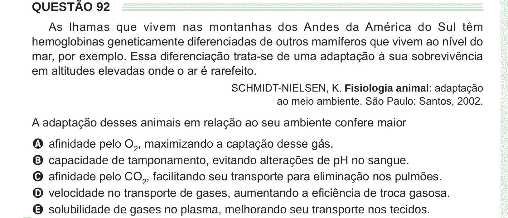

Texto extraído (pode conter ruído)

QUESTÃO 92  
As lhamas que vivem nas montanhas dos Andes da América do Sul têm  
hemoglobinas geneticamente diferenciadas de outros mamíferos que vivem ao nível do  
mar, por exemplo. Essa diferenciação trata-se de uma adaptação à sua sobrevivência  
em altitudes elevadas onde o ar é rarefeito.  
SCHMIDT-NIELSEN, K. Fisiologia animal: adaptação  
ao meio ambiente. São Paulo: Santos, 2002.  
A adaptação desses animais em relação ao seu ambiente confere maior  
A afinidade pelo O 2 , maximizando a captação desse gás.  
B capacidade de tamponamento, evitando alterações de pH no sangue.  
C afinidade pelo CO 2 , facilitando seu transporte para eliminação nos pulmões.  
D velocidade no transporte de gases, aumentando a eficiência de troca gasosa.  
E solubilidade de gases no plasma, melhorando seu transporte nos tecidos.

