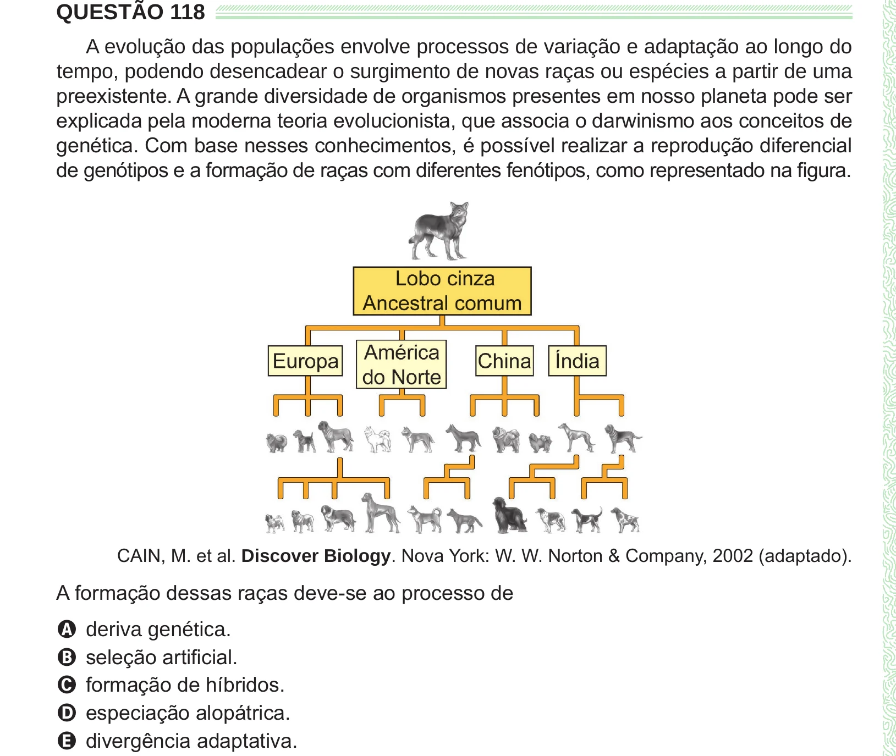

Texto extraído (pode conter ruído)

QUESTÃO 118  
A evolução das populações envolve processos de variação e adaptação ao longo do  
tempo, podendo desencadear o surgimento de novas raças ou espécies a partir de uma  
preexistente. A grande diversidade de organismos presentes em nosso planeta pode ser  
explicada pela moderna teoria evolucionista, que associa o darwinismo aos conceitos de  
genética. Com base nesses conhecimentos, é possível realizar a reprodução diferencial  
de genótipos e a formação de raças com diferentes fenótipos, como representado na figura.  
CAIN, M. et al. Discover Biology. Nova York: W. W. Norton & Company, 2002 (adaptado).  
A formação dessas raças deve-se ao processo de  
A deriva genética.  
B seleção artificial.  
C formação de híbridos.  
D especiação alopátrica.  
E divergência adaptativa.

